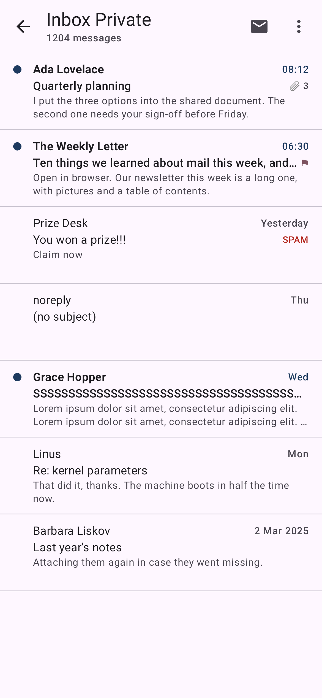
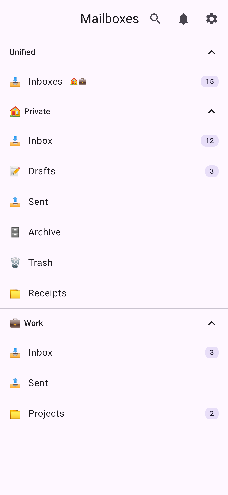
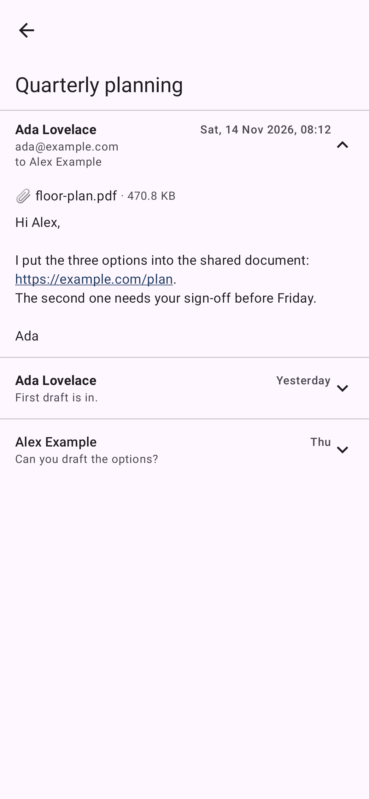
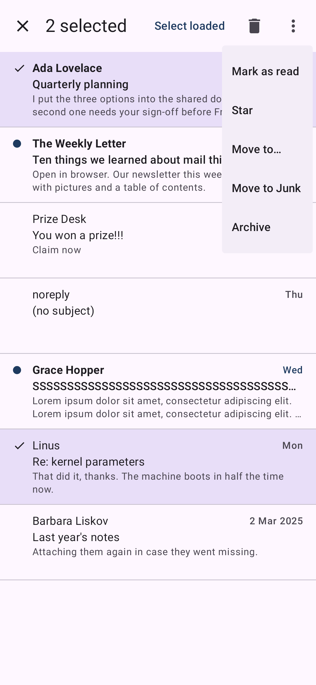

# MailVerdict for Android

[](https://github.com/frederikberg/mail-verdict-android/actions/workflows/ci.yml)
[](https://github.com/frederikberg/mail-verdict-android/releases)
[](https://opensource.org/licenses/MIT)

Native Android client for [MailVerdict](https://github.com/frederikberg/mail-verdict), a
self-hosted mail client with an AI spam layer. Your mail, folders and the spam verdicts of your own
server in a phone-sized app: a message list that holds still while mail arrives, a reader, swipes
and a selection for triage, and notifications without Google services.

<p align="center"></p>

## Why

- **The list does not jump.** Rows have one fixed height and are anchored by message id, so mail
  arriving above you, a page loading, or a trip into the reader and back never moves what you are
  reading. A test measures this on the real screen.
- **Actions are never lost.** Archive, delete, move, read and star show at once and go through a
  queue that is kept on the phone, sends in order, retries, waits while you are offline and never
  moves a message that is no longer where you saw it. Undo moves it back.
- **Mail you read can be read again offline.** The newest page of each list and every conversation
  you opened are kept on the phone and removed on sign-out.
- **Remote content is blocked until you ask.** Message HTML runs with script off, and nothing but
  the server's own attachments and, once you tap Show images, images is fetched.

<table>
<tr>
<td width="33%"></td>
<td width="33%"></td>
<td width="33%"></td>
</tr>
</table>

## How it fits together

```
phone app  ──REST + live events──▶  MailVerdict server  ──database──▶  PostIMAP  ──IMAP/SMTP──▶  mail server
```

The app never speaks IMAP or SMTP; the MailVerdict server does that for it, and the web UI of the
server is the reference for what the app ports. Signing in uses the server's identity provider in a
Chrome Custom Tab, and the session is sealed with a key that never leaves the phone's Keystore.

## What you need

A running MailVerdict server (see its README) that offers sign-in to apps. Android 8.0 or newer. For notifications, a UnifiedPush distributor app on the phone, such as
[ntfy](https://ntfy.sh) or Sunup: the app registers with it, and the server's own Web Push messages
reach the phone through it.

## Install

Download the APK of the latest [release](https://github.com/frederikberg/mail-verdict-android/releases)
and open it, or add the repository to [Obtainium](https://obtainium.imranr.dev/) to get updates.
Updates install over an existing copy because every release is signed with the same key.

Open the app, type the address of your server and sign in. Signing out also revokes the sign-in at the
identity provider, and the server lists the phone by its device name, so it can sign that one phone out.

## Building

JDK 21 and the Android SDK are all it takes; `docs/development.md` has the setup, the commands for
each kind of check, and how the modules fit together.

```bash
./gradlew :app:assembleDebug
```

A debug build started with `--ez fixture_mode true` shows canned data instead of reaching a server.

## Known limitations

- Folders can be created and deleted on the server, never renamed or re-nested; the app follows.
- No compose or reply yet, no calendar or contacts, no orders screens, no widgets.
- Moving a message into a glacier is not offered; moves across accounts in one selection are not
  supported.
- The app is not in Google Play.

## Docs

- [docs/development.md](docs/development.md): setup, modules, tests, fixture mode, the debug
  server, the API contract snapshot, push, and how a release is cut.

## Not affiliated

Not affiliated with or endorsed by Google, ntfy or the maintainers of Obtainium; their names belong
to their owners.

## License

[MIT](LICENSE)
